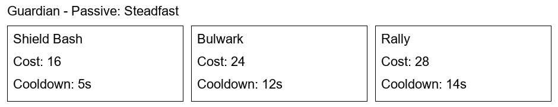

# Class ability designs

Design Lead: Isaac Moreno

- [Guardian ability sheet](guardian_ability_sheet.md) - 1 design point
- [Ranger ability sheet](ranger_ability_sheet.md) - 1 design point
- [Arcanist ability sheet](arcanist_ability_sheet.md) - 1 design point

Total: 3 design points.

[Combined PDF](class_ability_sheets.pdf)

The sheets contain passives, active abilities, costs, cooldowns, effects, and visual direction. They are design references for implementation and review. This submission does not add gameplay code.
